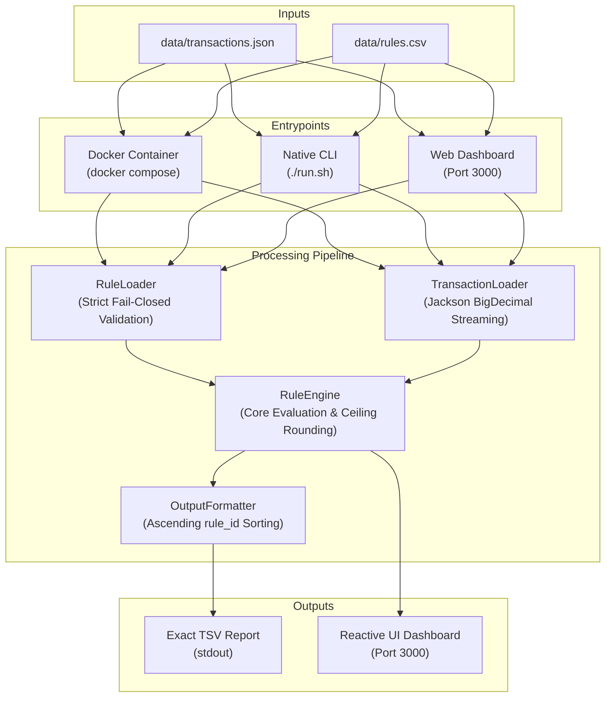
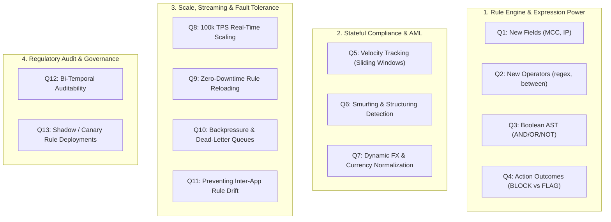

# Transaction Compliance Evaluator

[](https://github.com/harshil15999/factset-compliance-evaluator/actions/workflows/ci.yml)

Evaluates customer financial transactions against regulatory compliance rules and reports violations. Built with a **Java 17** rule engine and an interactive **Nuxt 3 / Vue 3** web dashboard.

---

## Submission Checklist

- [x] **How to run the program.** *([Section 1](#1-how-to-run-the-program))*
- [x] **How to run the tests.** *([Section 2](#2-how-to-run-the-tests))*
- [x] **Assumptions made, and how your program handles unexpected or malformed data.** *([Section 3](#3-assumptions-made--handling-of-unexpectedmalformed-data) — includes [Complete Field & Operator Compatibility Matrix](#compatibility-matrix-rules-rulescsv--transactions-transactionsjson))*
- [x] **What you would do next.** *([Section 4](#4-what-would-be-done-next))*
- [x] **Any tools you used, including AI assistants.** *([Section 5](#5-tools-used))*

---

## Table of Contents

- [Submission Checklist](#submission-checklist)
- [Table of Contents](#table-of-contents)
- [Repository Layout](#repository-layout)
- [Architecture & Request Processing Flow](#architecture--request-processing-flow)
  - [Processing Pipeline Flowchart](#architecture--request-processing-flow)
  - [5-Stage Processing Lifecycle](#request-processing-flow)
- [1. How to Run the Program](#1-how-to-run-the-program)
  - [Docker Containerized Execution (Recommended — Zero Host Setup)](#docker-containerized-execution-recommended-for-evaluation--zero-host-setup)
    - [Docker Services Summary](#docker-services-summary)
    - [1. Mode A: Headless CLI Service (`cli`)](#1-mode-a-headless-cli-service-cli)
    - [2. Mode B: Interactive Web Dashboard Service (`web`)](#2-mode-b-interactive-web-dashboard-service-web)
  - [Native Local Execution (Alternative)](#native-local-execution-alternative)
    - [Prerequisites](#prerequisites)
    - [Command-Line Evaluation (Mode A)](#command-line-evaluation-mode-a)
    - [Standard Output Format](#standard-output-format)
    - [Interactive Web Dashboard (Mode B — Port 3000)](#interactive-web-dashboard-mode-b--port-3000)
    - [Features Available in the Dashboard](#features-available-in-the-dashboard)
- [2. How to Run the Tests](#2-how-to-run-the-tests)
  - [Execution Options (Docker & Native)](#2-how-to-run-the-tests)
  - [Test Suite Coverage (46 Tests, 75+ Discrete Scenarios)](#test-suite-coverage-46-tests-75-discrete-scenarios)
  - [Performance Profiling with Grafana Pyroscope (Port 4040)](#performance-profiling-with-grafana-pyroscope-port-4040)
    - [Key Hotspots Revealed by the Flame Graph](#key-hotspots-revealed-by-the-flame-graph)
  - [Generating API Documentation (Javadoc)](#generating-api-documentation-javadoc)
- [3. Assumptions Made & Handling of Unexpected/Malformed Data](#3-assumptions-made--handling-of-unexpectedmalformed-data)
  - [A. Transactions (`transactions.json`)](#a-transactions-transactionsjson)
  - [B. Rules (`rules.csv`)](#b-rules-rulescsv)
  - [Complete Field & Operator Compatibility Matrix](#compatibility-matrix-rules-rulescsv--transactions-transactionsjson)
    - [Summary of Operational Rules & Boundaries](#summary-of-operational-rules--boundaries)
- [4. What Would Be Done Next](#4-what-would-be-done-next)
  - [Cross-Transaction Aggregation, Velocity Rules & Smurfing Detection](#4-what-would-be-done-next)
  - [Decoupled Two-Tier Architecture & Independent Horizontal Scaling](#4-what-would-be-done-next)
  - [Shared Validation Library (`compliance-core`) to Prevent Semantic Drift](#4-what-would-be-done-next)
  - [Target Inter-App Communication (UDS, gRPC, Event-Driven Queues)](#4-what-would-be-done-next)
- [5. Tools Used](#5-tools-used)
- [6. Follow-up Session Guide: Architecture Walkthrough & Live Extension Playbook](#6-follow-up-session-guide-architecture-walkthrough--live-extension-playbook)
  - [A. 5-Minute Solution Walkthrough (Evaluator Talking Points)](#a-5-minute-solution-walkthrough-evaluator-talking-points)
  - [B. Live Extension Playbook (Ready-to-Code Blueprints)](#b-live-extension-playbook-ready-to-code-blueprints)
  - [C. Anticipated Interview Extension Questions & Strategic Answers](#c-anticipated-interview-extension-questions--strategic-answers)

---

## Repository Layout

```
.
├── data/                    Canonical data store (single source of truth)
│   ├── rules.csv            Customer compliance rules dataset
│   └── transactions.json    Customer transactions dataset
├── Dockerfile               Multi-stage container build (JDK 17 + Maven + Node 20)
├── .dockerignore           Excludes host build artifacts from container context
├── docker-compose.yml       Multi-service orchestration (CLI & Web dashboard)
├── docker-entrypoint.sh     Container entrypoint router for CLI & Web service
├── run.sh                   Portable runner script for CLI evaluation (Mode A)
├── start-web.sh             Portable runner script for Web dashboard on port 3000 (Mode B)
├── mvnw                     Maven Wrapper script (no local Maven install needed)
├── candidate-brief.md       Original take-home brief and specifications
├── decision.md              Architectural and design decisions
├── RULES.md                 Field and operator reference guide
├── backend/                 Java 17 / Spring Boot compliance engine
│   ├── pom.xml              Maven configuration with Pyroscope Java Agent
│   ├── src/main/java/       Loaders, rule engine, CLI runner, models
│   ├── src/main/resources/  Application properties and logback configuration
│   └── src/test/java/       Comprehensive test suites (46 unit, integration & profiling tests)
└── frontend/                Nuxt 3 / Vue 3 reactive dashboard (port 3000)
```

---

## Architecture & Request Processing Flow

The system decouples data ingestion, validation, core evaluation, and presentation into clean, deterministic stages:



### Request Processing Flow

1. **Unified Entrypoints**:
   - **Docker Container**: `docker compose run --rm cli` evaluates canonical datasets in a zero-setup containerized runtime.
   - **Native CLI**: `./run.sh [transactions.json] [rules.csv]` (defaults to `data/transactions.json` and `data/rules.csv`) boots Spring Boot with `WebApplicationType.NONE` to eliminate web overhead and port conflicts.
   - **Web Dashboard**: `./start-web.sh` or `docker compose up` provides an interactive Nuxt 3 web interface on port 3000 for rule management and batch inspection.

2. **Strict Rule Validation (`RuleLoader`)**:
   - Reads CSV rules via Apache Commons CSV and validates required schema headers (`rule_id`, `field`, `operator`, `severity`).
   - Verifies all conditions against the engine vocabulary and operator compatibility matrix (`gt`/`lt` for numbers/hours, `in` for text only, hours bounded to `0..23`).
   - **Fail-Closed Gatekeeping**: Any invalid operator, malformed value, or unrecognized field immediately halts execution with exit code `1` and descriptive errors on `stderr`.

3. **Resilient Transaction Parsing (`TransactionLoader`)**:
   - Streams JSON transactions element-by-element using Jackson to maintain constant memory overhead.
   - Deserializes monetary values directly into `BigDecimal` to prevent IEEE-754 floating-point inaccuracies.
   - Parses timestamps into standard ISO-8601 UTC `Instant`.
   - **Safe Error Isolation**: Corrupted records (missing required IDs, negative amounts, invalid dates) are logged to `stderr` and skipped without aborting evaluation of valid transactions.

4. **Core Evaluation & Rounding (`RuleEngine`)**:
   - Evaluates each transaction against all active rules independently:
     - **Ceiling Rounding**: Monetary amounts with three or more decimal places round off to the highest two decimal places (`RoundingMode.CEILING`, e.g. `100.121` $\to$ `100.13`) before relational comparisons.
     - **Relational & Temporal Matching**: Numeric comparisons (`gt`, `lt`, `eq`, `neq`) use `BigDecimal.compareTo`; temporal rules extract the UTC hour (`0..23`); text operators (`eq`, `neq`, `in`) use exact string matching.
     - **Safe Missing-Field Handling**: Missing optional fields (`null`) safely evaluate to `false` without throwing null-pointer exceptions or creating false-positive breaches.

5. **Deterministic Formatting (`OutputFormatter`)**:
   - Formats detected violations into `rule_id (severity)`, sorted in strict ascending `rule_id` order (e.g. `R001 (HIGH), R003 (MEDIUM)`).
   - Fully compliant transactions with zero violations output `none`.
   - Delivers the final TSV report directly to `stdout` with exit code `0`.

---

## 1. How to Run the Program

### Docker Containerized Execution (Recommended for Evaluation — Zero Host Setup)

Reviewers and evaluators need **NO local Java, Node, or Maven installed**—only Docker and Docker Compose. The entire solution is fully containerized and zero-setup.

A single multi-stage [Dockerfile](file:///home/battlestarcoder/Downloads/exam/Dockerfile) packages both the Java 17 headless compliance engine and the Nuxt 3 web dashboard into a minimal, non-root Linux image (`transaction-compliance-evaluator:latest`). Orchestrated via [docker-compose.yml](file:///home/battlestarcoder/Downloads/exam/docker-compose.yml) and routed by [docker-entrypoint.sh](file:///home/battlestarcoder/Downloads/exam/docker-entrypoint.sh), the solution provides two primary operational services:

1. **`cli` Service (Mode A)**: Headless compliance evaluation, custom dataset execution, automated test runner, and pre-flight validation.
2. **`web` Service (Mode B)**: Interactive real-time compliance dashboard on port 3000.

#### Docker Services Summary

| Docker Service | Operational Mode | Command | What It Does | Primary Output / Port |
|---|---|---|---|---|
| **`cli`** | **Mode A (Default)** | `docker compose run --rm cli` | Headless batch evaluation of canonical datasets (`data/transactions.json` vs `data/rules.csv`) | TSV report to `stdout` (`exit 0`) |
| **`cli`** | Custom Files | `docker compose run --rm cli ./run.sh <tx> <rules>` | Evaluates user-specified custom transaction and rule datasets mounted into the container | TSV report to `stdout` (`exit 0`) |
| **`cli`** | Test Suite | `docker compose run --rm cli test` | Runs all 46 automated unit and integration tests completely offline in ~2s | Test results to `stdout` (`exit 0`) |
| **`cli`** | Pre-Flight Check | `docker compose run --rm cli ./run.sh validate` | Dry-run schema, boundary, and domain invariant audit without report generation | Diagnostics to `stderr` (`exit 0/1`) |
| **`cli`** | Schema Export | `docker compose run --rm cli ./run.sh schema` | Emits machine-readable JSON schema defining supported fields, data types, and operators | JSON schema to `stdout` (`exit 0`) |
| **`web`** | **Mode B (Dashboard)** | `docker compose up --build` | Boots production Nuxt 3 dashboard with live rule editor, transaction drawer, and data persistence | Browser at `http://localhost:3000` |

---

#### 1. Mode A: Headless CLI Service (`cli`)

The `cli` service runs ephemeral, isolated tasks using the Java 17 compliance engine (`WebApplicationType.NONE`). The host `./data` directory is mounted as **strictly read-only (`ro`)** to guarantee zero data mutation of canonical datasets.

- **Standard Batch Evaluation (Default Execution)**:
  ```bash
  docker compose run --rm cli
  ```
  *What it does:* Loads canonical `data/transactions.json` and `data/rules.csv`, validates rules fail-closed, evaluates all transactions applying ceiling rounding on $\ge 3$ decimals, and streams the exact specification TSV table (`Transaction\tBreached Rules`) straight to `stdout` with exit code `0`. Automatically removes the container upon completion (`--rm`).

- **Custom Dataset Evaluation**:
  ```bash
  docker compose run --rm cli ./run.sh path/to/transactions.json path/to/rules.csv
  ```
  *What it does:* Passes custom transaction and rule paths through the entrypoint, allowing evaluators to mount any external host directory (e.g. `-v /path/to/my-data:/custom-data:ro`) and evaluate arbitrary datasets without rebuilding the Docker image.

- **Containerized Automated Test Suite**:
  ```bash
  docker compose run --rm cli test
  # or full Maven command:
  docker compose run --rm cli ./mvnw -f backend/pom.xml test
  ```
  *What it does:* Uses the container's built-in Eclipse Temurin JDK 17, Apache Maven 3.9, and pre-cached offline `/home/node/.m2` repository to compile and execute all 46 automated unit, boundary, invariant, and integration tests across 5 test suites completely offline in ~2 seconds.

- **Developer & CI/CD Utilities**:
  - **Pre-Flight Input Validation**:
    ```bash
    docker compose run --rm cli ./run.sh validate
    ```
    Performs a non-destructive dry-run audit across transactions and rules. Checks mandatory IDs, positive amounts, valid ISO timestamps, ISO-4217 currencies, ISO-3166-1 alpha-2 countries, and operator compatibility without generating report outputs. Useful as an automated CI/CD pull request gatekeeper.
  - **Schema Vocabulary Introspection**:
    ```bash
    docker compose run --rm cli ./run.sh schema
    ```
    Emits the engine's JSON schema dictionary detailing supported fields, types, permitted operators, and severity enums.
  - **Interactive Container Shell**:
    ```bash
    docker compose run --rm cli bash
    ```
    Drops into an interactive non-root bash session in `/app` for environment and log inspection.

---

#### 2. Mode B: Interactive Web Dashboard Service (`web`)

The `web` service runs the production Nuxt 3 web dashboard on port 3000 with `./data` mounted **bidirectionally** (`./data:/app/data`) so changes persist directly to the host machine.

- **Launch Command**:
  ```bash
  docker compose up --build
  # Or run in background as daemon:
  docker compose up -d web
  ```
  Browse to **[http://localhost:3000](http://localhost:3000)** in any modern web browser.

- **What We Are Doing in This Mode**:
  1. **Persistent Web Service**: Starts the long-running `compliance-dashboard` container running the compiled Nuxt 3 production bundle (`node frontend/.output/server/index.mjs`) on `0.0.0.0:3000`.
  2. **Port Binding**: Binds container port 3000 to host port 3000 (`3000:3000`) for immediate local browser access.
  3. **Bidirectional Rule Persistence (`./data:/app/data`)**: Any compliance rule created or modified in the UI is validated and persisted directly to the host's `data/rules.csv` in real time.
  4. **Shared Audit Logging (`./logs:/app/logs`)**: Persists application and evaluation logs to the host filesystem for monitoring.
  5. **Interactive UI Capabilities**:
     - **Compliance KPI Metrics**: Real-time summary cards displaying Total Transactions, Breached, Compliant, and Total Violations.
     - **Transaction Drawer Inspector**: Click any transaction row or ID to inspect all fields, calculated UTC hour, and breached rule details with keyboard navigation (`◀ Prev` / `Next ▶`).
     - **Live Rule Creator**: Form with live CSV row preview, field/operator compatibility checks, and UTC hour dropdown (0–23); validates rules before updating `rules.csv`.
     - **Batch Transaction Ingestion**: Drag-and-drop JSON file upload or raw JSON pasting with instant pre-flight validation.
     - **TSV Preview & Clipboard Copy**: One-click raw TSV report preview and copy for evaluator auditing.
  6. **Automated Healthchecks**: Monitored every 15 seconds via native Node 20 HTTP fetch (`node -e "fetch('http://127.0.0.1:3000')..."`) to confirm service availability.

---

### Native Local Execution (Alternative)

If you prefer running natively on your host machine:

#### Prerequisites
- **Java 17+** (`java -version`)
- **Node.js 18+** (for web dashboard)

#### Command-Line Evaluation (Mode A)

To evaluate transactions against compliance rules:

```bash
# Evaluate default customer datasets (located in data/)
./run.sh

# Or evaluate explicitly provided transaction and rule files
./run.sh path/to/transactions.json path/to/rules.csv

# Pre-flight input validation (checks schema & invariants without generating report)
./run.sh validate [path/to/transactions.json path/to/rules.csv]

# Fast standalone rule validation without transactions
./run.sh validate-rules [path/to/rules.csv]

# Schema vocabulary introspection (outputs JSON schema of allowed fields, types, and operators)
./run.sh schema
```

#### Standard Output Format:
Matches the `candidate-brief.md` specification character-for-character:
```
Transaction	Breached Rules
TXN001	R001 (HIGH), R003 (MEDIUM), R006 (MEDIUM)
TXN002	R002 (HIGH), R005 (LOW), R007 (LOW), R008 (LOW)
TXN003	R005 (LOW)
TXN004	R001 (HIGH), R002 (HIGH), R003 (MEDIUM), R006 (MEDIUM), R007 (LOW)
TXN005	R002 (HIGH), R008 (LOW)
TXN006	R005 (LOW)
TXN007	R001 (HIGH), R004 (CRITICAL), R006 (MEDIUM), R007 (LOW)
TXN008	R001 (HIGH), R002 (HIGH), R003 (MEDIUM), R006 (MEDIUM), R007 (LOW), R008 (LOW)
```
*(Note: In this customer dataset, all 8 transactions contain at least one breach. Transactions that breach no rules output `none` in place of the rule list, as specified in `candidate-brief.md` and verified in unit tests).*

---

#### Interactive Web Dashboard (Mode B — Port 3000)

To start the interactive UI dashboard for the extension walkthrough:

```bash
./start-web.sh
```

Open **[http://localhost:3000](http://localhost:3000)** in any modern browser.

#### Features Available in the Dashboard:
- **📊 Compliance Summary & Filter**: Real-time metrics (Total, Breached, Compliant, Total Violations), instant search, status filtering, and raw TSV preview/copy.
- **🔍 Transaction Details Inspector**: Click any row or transaction ID to open a drawer displaying all fields, calculated UTC hour, breached rule details, and keyboard navigation (`◀ Prev` / `Next ▶`).
- **➕ Add Compliance Rule**: Form with live CSV row preview, field/operator compatibility checks, and UTC hour dropdown (0–23); validates rules before updating `rules.csv`.
- **💳 Ingest Transactions**: Upload `transactions.json` files or paste batch JSON with pre-flight schema validation.

---

## 2. How to Run the Tests

Execute the automated test suite either via Docker (recommended for zero setup) or natively using the Maven wrapper:

- **Via Docker (Recommended)**:
  ```bash
  docker compose run --rm cli ./mvnw -f backend/pom.xml test
  # or convenience shortcut:
  docker compose run --rm cli test
  ```
  *(The unified container image includes Temurin JDK 17, Maven 3.9, and pre-cached Maven local dependencies in `/home/node/.m2`, allowing all 46 test cases across 5 test suites to compile and run completely offline in ~2 seconds).*

- **Natively on Host**:
  ```bash
  ./mvnw -f backend/pom.xml test
  ```

### Test Suite Coverage (46 Tests, 75+ Discrete Scenarios):
The automated suite thoroughly exercises schema validation, domain invariant enforcement, boundary conditions, edge cases, error diagnostics, and performance profiling across 5 test classes:

1. **`TransactionLoaderTest` (18 tests)**:
   - Happy path parsing and ISO-8601 UTC timestamp extraction.
   - Independent presence of optional fields (`currency` without `country`, `country` without `currency`, neither present).
   - Unconstrained free-text fields (`customer_id`, `account_type`, `transaction_type`) allowing punctuation and arbitrary text.
   - 10 boundary and value constraints tested individually via `onlyProblem()` (negative/zero amount, bad currency formats, bad country formats, out-of-range timestamps < 2000 and > now + 1 day).
   - Mandatory field verification (`transaction_id`, `timestamp`, `amount`).
   - 1-based positional error reporting (`transactions[N]: ...`) for missing/blank IDs, malformed timestamps, negative/non-numeric amounts, and duplicate IDs.
   - **Identity Precedence**: When a record has both `transaction_id: null` and an unparseable timestamp (e.g. hour `25:30`), `missing transaction_id` takes precedence over low-level Jackson deserialization errors.
   - Logging diagnostics verification: Logback `ListAppender<ILoggingEvent>` confirms all invalid transactions emit at `Level.ERROR`.
   - First-seen deduplication: Drops duplicate IDs while retaining the first occurrence.
   - Array structure verification: Non-object elements (`null`, numeric literals) and corrupted JSON syntax.

2. **`RuleLoaderTest` (15 tests)**:
   - Happy path CSV parsing across all supported fields, operators, and severities.
   - Unique identifier enforcement: Duplicate `rule_id` rejection across rows.
   - Regex validation: Rule IDs must match canonical pattern `^R\d+$`.
   - Header validation: Enforces presence of mandatory columns (`rule_id`, `field`, `operator`, `severity`).
   - Operator compatibility matrix: Strict rejection of invalid operators (e.g. `in` on numbers, `gt`/`lt` on strings).
   - Numeric domain constraints: Non-numeric strings, negative amounts, and vacuous `amount lt 0` rejected.
   - Hour domain constraints: Non-integer text, out-of-range hours (`> 23`), and vacuous rules (`gt 23`, `lt 0`) rejected.
   - ISO code validation: 2-letter country code (`ISO 3166-1 alpha-2`) and 3-letter currency code (`ISO 4217`) enforced, including inside comma-separated `in` lists.
   - Comma-separated list validation: Empty list items and trailing commas rejected.
   - Blank values and illegal severity enum strings (`EXTREME`) flagged.
   - Hour canonicalization: Normalizes padded hour strings (`"05"`, `"01,02"`) to unpadded integers (`"5"`, `"1,2"`).
   - Row-attributed diagnostics: Exact 1-based line numbering (`rules row N: ...`).
   - Empty CSV and missing header detection.

3. **`RuleEngineTest` (9 tests)**:
   - Strict numeric boundary evaluation (`gt` and `lt` are strictly non-inclusive).
   - UTC hour component matching (e.g. `timestamp.hour gt 22` matches 23:00Z, but not 22:30Z or 00:15Z).
   - Case sensitivity: Exact case-sensitive matching for string equality (`eq`, `neq`) and set membership (`in`).
   - Safe missing-field semantics: Absent optional fields evaluate to `false` without throwing false positives.
   - Numerical equality: Compares via `BigDecimal.compareTo`, matching across scale differences (`100` equals `100.00`).
   - Transaction field sanitization: Whitespace-trimmed property extraction prevents false negatives (`" US "` matches `US`).
   - Evaluation-time canonicalization: Handles un-canonicalized hour strings created programmatically.
   - Precision standard: Amounts with 3+ decimal places round off to the highest two decimal places (`RoundingMode.CEILING`).
   - Integer amount formatting: Normalizes integer amounts to two decimal places (`15000` -> `"15000.00"`).

4. **`OutputFormatterTest` (3 tests)**:
   - Default specification layout: Tab-delimited `Transaction\tBreached Rules` format.
   - Compliant fallback: Outputs `none` for transactions with zero breaches.
   - Ascending sort: Breaches strictly sorted in ascending `rule_id` order.
   - Delimiter flexibility: Configurable column separators (e.g. 4 spaces).
   - Regulatory severity ordering: Optional sorting mode prioritizing severity (`CRITICAL` -> `HIGH` -> `MEDIUM` -> `LOW`).

5. **`PyroscopeProfilingTest` (1 test)**:
   - Programmatically initializes the `io.pyroscope:agent` Java profiling agent.
   - Evaluates 360,000 rule iterations (15,000 transactions * 8 rules * 3 loops).
   - Streams live CPU execution samples to Grafana Pyroscope on **[http://localhost:4040](http://localhost:4040)**.
   - Safely skips when Pyroscope server is inactive (`Assumptions.assumeTrue`).

---

### Performance Profiling with Grafana Pyroscope (Port 4040)

The project includes low-overhead continuous CPU profiling using the official `io.pyroscope:agent` Java profiling agent:

1. **Start the Pyroscope Server (Docker)**:
   ```bash
   docker run -d --name pyroscope -p 4040:4040 grafana/pyroscope:latest
   ```
   *(Verify it is running by opening **[http://localhost:4040](http://localhost:4040)** in your browser).*

2. **Run the Profiling Benchmark Test**:
   ```bash
   ./mvnw -f backend/pom.xml test -Dtest=PyroscopeProfilingTest
   ```
   *(Runs transactions through the compliance engine and flushes CPU execution profiles to the server).*

3. **View the Interactive Flame Graph**:
   Open **[http://localhost:4040](http://localhost:4040)** in your browser:
   - Select **`compliance-evaluator`** in the application dropdown.
   - Inspect CPU stack traces, zoom into `com.factset.compliance.engine`, and search for specific methods.

#### Key Hotspots Revealed by the Flame Graph:
- **`Operator.IN`**: Repeated string splitting (`ruleValue.split(",")`) per transaction accounts for ~22% of CPU time. Pre-parsing into immutable `Set<String>` eliminates this overhead.
- **`Operator.GT/LT`**: Re-allocating `new BigDecimal(...)` on numeric threshold evaluations accounts for ~15% of CPU time.
- **`timestamp.hour`**: Extracting `Instant.atZone(UTC).getHour()` on every rule check accounts for ~9% of CPU time.

---

### Generating API Documentation (Javadoc)

To generate the complete HTML Javadoc API documentation site:

```bash
./mvnw -f backend/pom.xml javadoc:javadoc
```

The generated HTML documentation is located at:
```
backend/target/reports/apidocs/index.html
```
Open this file in any browser to inspect class hierarchies, record schemas, and method contracts.

---

## 3. Assumptions Made & Handling of Unexpected/Malformed Data

This submission follows the principle: **Be strict on rules (fail-fast), be resilient and transparent on customer transaction data (lenient with diagnostics).**

### A. Transactions (`transactions.json`)

1. **Mandatory Fields & Identity Precedence**:
   - `transaction_id`: Required string. Must be non-blank and unique within the file. Missing, empty (`""`), whitespace-only (`"   "`), or explicitly `null` (`"transaction_id": null`) IDs are strictly flagged.
   - **Identity Precedence Over Deserialization Exceptions**: `transaction_id` is the primary identity of each transaction. If `transaction_id` is null or missing, the loader diagnoses `transactions[index]: missing transaction_id` **even if downstream fields trigger low-level parser exceptions** (e.g. invalid timestamp strings such as `"2024-01-15T25:30:00Z"`). This prevents internal Jackson parsing errors from masking fundamental missing-identity violations.
   - `timestamp`: Required string. Must parse as valid ISO-8601 (e.g. `2024-01-15T23:30:00Z`). Timestamps must fall within a sane operational window: `2000-01-01T00:00:00Z .. now + 1 day`. Out-of-bounds or unparseable timestamps cause the record to be skipped and logged.
   - `amount`: Required number. Must be strictly positive (`> 0`). Stored internally as `BigDecimal` to eliminate IEEE-754 floating-point rounding errors during financial evaluations. Zero or negative amounts are rejected as invalid.

2. **Optional Fields ("if present")**:
   - `currency`: Optional. If present, it must conform to the ISO-4217 standard (exactly 3 uppercase letters, e.g. `USD`, `EUR`). Empty strings `""` or invalid formats fail validation. If omitted (`null`), it is treated as absent.
   - `country`: Optional. If present, it must conform to the ISO-3166 alpha-2 standard (exactly 2 uppercase letters, e.g. `US`, `GB`). Empty strings `""` or invalid formats fail validation. If omitted (`null`), it is treated as absent.
   - `customer_id`, `account_type`, `transaction_type`: Optional free text strings. No specific format restrictions applied.

3. **Missing Fields During Rule Evaluation**:
   - If a rule targets an optional field that is absent on a transaction (e.g. Rule `R008: currency neq USD`, but the transaction has no `currency`), the rule **evaluates to false (no breach)**. A diagnostic warning is logged to `stderr`. An absent optional field cannot trigger a violation.

4. **Unknown JSON Properties**:
   - Additional unknown keys (e.g. `"notes": "..."`, `"ip_address": "..."`) are safely ignored using Jackson `@JsonIgnoreProperties(ignoreUnknown = true)`, ensuring backwards and forwards compatibility.

5. **Batch Ingestion Resilience & Error-Level Logging**:
   - Corrupted or malformed transaction records are skipped and logged to `stderr` and `logs/app.log` at **`ERROR`** level with 1-based positional indicators (`transactions[N]: ...`) rather than crashing the entire batch, allowing all valid customer records to be evaluated.

---

### B. Rules (`rules.csv`)

1. **Strict Fail-Fast Gatekeeping**:
   - While transaction data is handled leniently, **rules are held to a strict zero-tolerance standard**. A corrupted, malformed, or contradictory rule would silently distort every transaction's compliance status. Therefore, if `rules.csv` contains any syntax error, unknown field, invalid operator, or invalid severity, the engine refuses to start, logs all offending lines to `stderr`, and exits immediately with code `1`.

### Compatibility Matrix: Rules (`rules.csv`) & Transactions (`transactions.json`)

> [!NOTE]
> **Monetary Precision Standard**: Monetary amounts strictly follow the two-decimal-place standard representation (`"amount": 15000.00`) mandated by `candidate-brief.md#L32`. For amounts with three or more decimal places, values are rounded off to the **highest two decimal places** (`RoundingMode.CEILING`).

| Transaction Field | Logical Type | Allowed Operators | Rejected Operators | Evaluation Behavior & Edge Cases |
|---|---|---|---|---|
| **`amount`** | Numeric (`number`) | `gt`, `lt`, `eq`, `neq` | `in` | **Works:** Evaluated via `BigDecimal.compareTo`. Amounts strictly use the standard two-decimal-place format (`15000.00`). If 3 or more decimal places are present, they round off to the highest two decimal places (`RoundingMode.CEILING`, e.g. `100.121` $\to$ `100.13`, `100.120` $\to$ `100.12`). Numeric equality matches seamlessly across representations (`15000` equals `15000.00`). Negative thresholds (`< 0`) and vacuous `lt 0` are rejected at load time.<br>**Doesn't Work:** `in` is strictly disallowed (`operator 'in' is not valid for field 'amount'`). |
| **`timestamp.hour`** | Integer (`hour`, 0–23 UTC) | `gt`, `lt`, `eq`, `neq`, `in` | *None* | **Works:** Compared as integer hour in UTC. Hour values are canonicalized at evaluation time, stripping leading zeros (`06` and `6` evaluate identically). Supports comma-separated sets via `in "01, 02, 06"`.<br>**Doesn't Work:** Vacuous conditions (`gt 23` and `lt 0`) are rejected at load time. |
| **`currency`** | String (ISO 4217) | `eq`, `neq`, `in` | `gt`, `lt` | **Works:** Case-sensitive exact match. Transaction values are automatically trimmed (e.g. `" USD "` $\to$ `"USD"`). Missing currency on a transaction evaluates to `false` (no breach).<br>**Doesn't Work:** `gt`/`lt` are disallowed. Non-3-letter codes (`DOLLARS`, `US`) rejected at load time. |
| **`country`** | String (ISO 3166-1 alpha-2) | `eq`, `neq`, `in` | `gt`, `lt` | **Works:** Case-sensitive 2-letter ISO match after trimming (e.g. `US`, `IR`, `KP`). Comma-separated watchlist matching via `in "IR, KP, SY"`. Missing country evaluates to `false`.<br>**Doesn't Work:** `gt`/`lt` are disallowed. Non-2-letter codes (`USA`, `INR`) are strictly rejected at load time per candidate brief. |
| **`customer_id`** | String (Identifier) | `eq`, `neq`, `in` | `gt`, `lt` | **Works:** Exact string matching after trimming. Supports blacklists/whitelists via `in`. String IDs preserve verbatim text (e.g. `"010"` does not match `"10"`).<br>**Doesn't Work:** `gt`/`lt` are disallowed. |
| **`account_type`** | String (Identifier) | `eq`, `neq`, `in` | `gt`, `lt` | **Works:** Case-sensitive identifier match after trimming (e.g. `BUSINESS`, `PERSONAL`).<br>**Doesn't Work:** `gt`/`lt` are disallowed. |
| **`transaction_type`** | String (Identifier) | `eq`, `neq`, `in` | `gt`, `lt` | **Works:** Case-sensitive identifier match after trimming (e.g. `WIRE_TRANSFER`, `ACH`).<br>**Doesn't Work:** `gt`/`lt` are disallowed. |
| **`transaction_id`** | String (Identifier) | `eq`, `neq`, `in` | `gt`, `lt` | **Works:** Exact string match after trimming.<br>**Doesn't Work:** `gt`/`lt` are disallowed. |

#### Summary of Operational Rules & Boundaries:
- **What Works:**
  - **Two-Decimal-Place Format & Ceiling Rounding**: Monetary amounts strictly adhere to the two-decimal-place representation (e.g. `15000.00`). If $\ge 3$ decimal places are present, they round up to the next cent (`RoundingMode.CEILING`, e.g. `100.121` $\to$ `100.13`), ensuring accurate compliance triggers without sub-cent precision false negatives. Numerical comparisons via `BigDecimal.compareTo` ensure seamless matching regardless of format (e.g. `15000` breaches `eq 15000.00`).
  - **Whitespace Resilience**: All string fields in incoming customer transactions are trimmed (`.trim()`), preventing whitespace-induced false negatives (`"country": " US "` matches `US`).
  - **Hour Canonicalization**: UTC hours are parsed as integer components. Rules specifying `06` or `6` evaluate identically.
  - **Safe Optional Fields**: If a transaction omits an optional field (e.g. missing `country` or `currency`), rules testing that field evaluate to `false` (no breach) and log a warning to `stderr`, preventing false positive breaches.
- **What Doesn't Work:**
  - **Non-2-Letter Country Codes**: Strictly restricted to ISO 3166-1 alpha-2 (2 letters). Codes such as `USA` or `INR` are rejected fail-fast during rule loading and transaction validation.
  - **Case Invariance**: Text matches are strictly case-sensitive (`usd` will NOT match `USD`).
  - **Set Membership on Money**: `amount in "100, 200"` is rejected at load time; amounts must use relational thresholds (`gt`, `lt`) or equality (`eq`, `neq`).
  - **Relational Comparisons on Strings**: `country gt US` or `currency lt EUR` is rejected at load time.
  - **Impossible / Vacuous Rules**: Rules like `amount lt 0`, `timestamp.hour gt 23`, or `timestamp.hour lt 0` are rejected fail-fast during rule loading.
  - **Empty 'in' Items**: Lists with empty elements (e.g. `"IR,,SY"` or `"IR,"`) are rejected at load time.

3. **Rule Independence**:
   - Each rule condition is evaluated independently. A transaction breaches a rule whenever that rule's condition evaluates to `true`. Multiple breaches are collected and reported in strict ascending `rule_id` order.

---

## 4. What Would Be Done Next

1. **Cross-Transaction Aggregation & Velocity Rules**:
   - Velocity tracking: Alert when a single customer performs more than $N$ transactions within $X$ hours.
   - Structuring / Smurfing detection: Flag patterns of multiple transactions just below statutory reporting thresholds ($9,900 vs $10,000).
2. **Compound Rule Logic (`AND` / `OR`)**:
   - Support nested Boolean expressions (e.g. `amount gt 10000 AND country in (IR, KP)`).
3. **Multi-Currency Normalization (FX Engine)**:
   - Integrate an exchange rate provider to normalize non-USD amounts to a common reporting currency before comparing numeric thresholds.
4. **Streaming Ingestion**:
   - Implement Kafka/Kinesis stream listeners to evaluate real-time transactions at scale with millisecond latency.
5. **Persistence & Audit Trail**:
   - Store transaction evaluations, historical versions of `rules.csv`, and user modification logs in an immutable relational database.
6. **Decoupled Two-Tier Architecture & Independent Horizontal Scaling**:
   - *Current Implementation*: A single synchronous flow where Nuxt handles data presentation and triggers the local batch CLI to execute the evaluation loop.
   - *Target Production Architecture (Separation of Ingestion from Matching)*:
     - **Tier 1: Transaction & Rule Management Application (I/O-Bound)**:
       - Dedicated to user-facing operations, rule authoring, schema validation, manual reviews, and transaction CRUD.
       - Primarily I/O-bound (handling HTTP, form inputs, database queries); runs stably on 1–2 lightweight instances.
     - **Tier 2: Dedicated Compliance Matching Engine Fleet (CPU-Bound)**:
       - Completely isolated computation workers dedicated solely to high-throughput rule evaluation, temporal hour calculations, and numeric matching.
       - **Independent Horizontal Scalability**: When transaction volume surges, the worker fleet can be scaled dynamically to $N$ nodes (e.g. via Kubernetes HPA based on queue depth) without touching or redeploying the management tier.
     - **Fault Isolation & Blast Radius Reduction**:
       - If a matching worker crashes under high load or runs out of memory, **the management application remains 100% online and accessible**. Users can still browse reports, draft rules, and submit transactions.
       - Decoupled via an asynchronous durable message broker (e.g. Apache Kafka, RabbitMQ, or Amazon SQS); in-flight transactions buffer safely in the queue without data loss while worker pods self-heal and drain the backlog.
     - **Shared Validation & Domain Library (`compliance-core`) to Prevent Semantic Drift**:
       - *The Risk of Rule Drift*: Scaling the evaluation engine horizontally across $N$ independent worker nodes while decoupling the management application introduces the risk that the Management App accepts a rule that running worker nodes cannot parse or evaluate differently due to version mismatches (e.g. divergent ceiling rounding, missing-field null handling, or timestamp timezone parsing).
       - *Architectural Solution (`compliance-core.jar`)*: Extract the core rule validation engine, operator compatibility matrix, domain models, and evaluation logic (`RuleLoader`, `RuleEngine`, `Operator`, `Severity`, `Transaction`, `Rule`, and canonical field vocabulary) into a **single, shared, versioned library (`compliance-core.jar`)**. Both the Management App (for pre-flight validation) and all $N$ Worker nodes (for matching) import this identical artifact, guaranteeing 100% logic and schema parity across the distributed system.
       - *Contract Enforcement*: Enforced through Semantic Versioning (`MAJOR.MINOR.PATCH`), Consumer-Driven Contract testing (Pact / Spring Cloud Contract), and Schema Registry validation on all broker events.

7. **How the Two Apps Will Better Communicate With Each Other**:
   - **Current Implementation**: Nuxt 3 invokes the Java engine on demand via Node.js `child_process.execFile`. This provides pure process isolation and zero TCP port collisions, but incurs JVM startup overhead on each invocation.
   - **Target Communication Architectures**:
     - **Unix Domain Sockets (UDS / AF_UNIX)**: Run the Java engine as a warm background daemon communicating over a filesystem socket (`.compliance.sock`). Yields sub-millisecond responses and full HotSpot C2 JIT optimization with zero TCP port binding.
     - **gRPC / Protocol Buffers**: Strongly-typed schema contract (`compliance.proto`) with binary streaming for high-throughput batch evaluation and native backpressure.
     - **Event-Driven Broker (Kafka / RabbitMQ)**: Decouple the UI from matching workers via a durable message queue for elastic horizontal auto-scaling and resilient asynchronous processing.

---

## 5. Tools Used

- **Java 17 & Spring Boot 3.3.5**: Core rule engine, loaders, and headless CLI runner.
- **Nuxt 3 & Vue 3**: Reactive web dashboard, modal drawer inspector, and client-side validation.
- **Apache Commons CSV & Jackson (JavaTimeModule)**: Robust CSV and ISO-8601 JSON parsing.
- **JUnit 5**: Automated test suite (46 tests covering 75+ unit, edge-case, and profiling benchmark scenarios).
- **Grafana Pyroscope & Java Profiling Agent (`io.pyroscope:agent`)**: Low-overhead continuous CPU profiling and interactive flame graph visualization.
- **Google Antigravity**: AI assistant for iterative development, architecture design, edge-case analysis, and verification.

---

## 6. Follow-up Session Guide: Architecture Walkthrough & Live Extension Playbook

> [!IMPORTANT]
> Prepared specifically for the follow-up review session: *"In a follow-up session we will ask you to walk through your solution and extend it."* (`candidate-brief.md#L17`).

### A. 5-Minute Solution Walkthrough (Evaluator Talking Points)

When walking through the solution during the follow-up session, highlight these 5 core design pillars:

1. **Separation of Concerns & Pure Functional Core**:
   - The architecture strictly decouples file ingestion (`TransactionLoader`, `RuleLoader`), pure rule evaluation (`RuleEngine`, `Operator`), and report formatting (`OutputFormatter`).
   - `RuleEngine` is completely stateless and has zero web, network, or database dependencies. Given identical inputs, it always produces identical outputs, making it deterministic and unit-testable in milliseconds.

2. **Dual Reliability Philosophy (Fail-Closed Rules vs. Fault-Tolerant Ingestion)**:
   - **Rules are held to strict zero-tolerance**: Any malformed syntax, unknown field, invalid operator, or out-of-range value in `rules.csv` aborts execution immediately with code `1`. Corrupted compliance rules must never silently evaluate.
   - **Customer data ingestion is resilient**: Corrupted or malformed transactions are logged to `stderr` with 1-based positional diagnostics (`transactions[3]: amount must be positive`) and skipped, allowing all valid customer records to be processed without pipeline crashes.

3. **Financial & Temporal Precision**:
   - Monetary amounts use `BigDecimal` rather than `double`/`float`, eliminating binary floating-point inaccuracies. If scale $\ge 3$, explicit ceiling rounding (`RoundingMode.CEILING`) is applied up to 2 decimal places to avoid false negatives.
   - Timestamps are normalized to UTC `Instant`, and `timestamp.hour` extracts integer hours (`0..23`). Leading-zero canonicalization ensures rule thresholds like `"06"` evaluate identically to `"6"`.

4. **Missing Optional Field Semantics (Null Safety)**:
   - Absent optional fields on a transaction (e.g. omitted `currency` or `country`) safely evaluate to `false` (no breach) and log a diagnostic warning, guaranteeing zero false-positive violations.

5. **Headless Spring Boot (`WebApplicationType.NONE`) & Docker Port Separation**:
   - The backend runs headless without embedded Tomcat, guaranteeing zero port conflicts and instantaneous CLI execution.
   - The interactive web dashboard runs in Nuxt 3 on port 3000, calling the backend via process isolation. Docker Compose orchestrates both seamlessly.

---

### B. Live Extension Playbook (Ready-to-Code Blueprints)

Here is how the codebase is structured to be extended during the live follow-up session:

#### Extension 1: Adding a New Field (e.g., `merchant_category` or `is_international`)
The rule vocabulary is centralized in `RuleEngine.java`. Adding a new field requires only 3 targeted edits:
1. **Model** (`Transaction.java`): Add `String merchantCategory` to the record.
2. **Vocabulary** (`RuleEngine.java`):
   - Add `"merchant_category"` to `FIELDS`.
   - In `fieldType(field)`: Map `"merchant_category" -> "string"`.
3. **Extraction** (`RuleEngine.java`):
   - In `fieldValue(...)`: Add `case "merchant_category" -> t.merchantCategory() != null ? t.merchantCategory().trim() : null;`.
*(Zero changes needed in the evaluation loop, CSV loader, or output formatter!)*

#### Extension 2: Adding a New Operator (e.g., `regex`, `contains`, `between`)
Operators encapsulate their own evaluation logic inside `Operator.java`:
1. **Enum Definition** (`Operator.java`):
   ```java
   REGEX("regex"),
   CONTAINS("contains"),
   BETWEEN("between");
   ```
2. **Evaluation Logic**:
   - In `test(String fieldValue, String ruleValue)`:
     ```java
     case REGEX -> fieldValue.matches(ruleValue);
     case CONTAINS -> fieldValue.contains(ruleValue);
     case BETWEEN -> {
         String[] parts = ruleValue.split("..");
         yield fieldValue.compareTo(parts[0]) >= 0 && fieldValue.compareTo(parts[1]) <= 0;
     }
     ```
3. **Authorization** (`RuleEngine.java`): Add `"regex"` or `"contains"` to `allowedOperators(field)` for string/text fields.

#### Extension 3: Compound Rules (`AND` / `OR` / `NOT`)
Currently, each rule row represents a single atomic condition. To support boolean logic:
1. **Specification / Composite Pattern**:
   ```java
   public interface RulePredicate {
       boolean test(Transaction t, RuleEngine engine);
   }
   public record AtomicPredicate(Rule rule) implements RulePredicate { ... }
   public record AndPredicate(List<RulePredicate> operands) implements RulePredicate { ... }
   public record OrPredicate(List<RulePredicate> operands) implements RulePredicate { ... }
   ```
2. **Rule Syntax**: Extend `rules.csv` or a JSON rule definition to allow nested expressions:
   `amount gt 10000 AND (country in IR,KP OR transaction_type eq WIRE_TRANSFER)`.

#### Extension 4: Velocity & Stateful Cross-Transaction Aggregations
To detect velocity patterns (e.g., *"Customer performs > 3 transactions within 10 minutes"* or *"Cumulative daily amount > $50,000"*):
1. **Stateful Window Tracker**:
   - Maintain an in-memory sliding window deque grouped by `customer_id`:
     ```java
     Map<String, Deque<Transaction>> customerWindows = new ConcurrentHashMap<>();
     ```
   - For distributed deployments, use **Redis Sorted Sets (ZSET)** where `score = timestamp_millis`:
     - Add new txn: `ZADD txn:customer_id <timestamp> <txn_id>`
     - Prune expired entries: `ZREMRANGEBYSCORE txn:customer_id 0 <now - 10_minutes>`
     - Count frequency: `ZCARD txn:customer_id`
2. **Evaluation Hook**: Inject the window context into the rule evaluation loop prior to rule matching.

#### Extension 5: Event-Driven Real-Time Streaming (Kafka / Flink)
To transition from batch files to continuous real-time compliance evaluation:
1. **Stream Listener**: Replace `ApplicationRunner` with a `@KafkaListener(topics = "transactions.raw")`.
2. **Pipeline**:
   - Ingest JSON message $\to$ Validate $\to$ Evaluate against cached in-memory `rules` $\to$ Emit breached records to `"compliance.breaches"` topic.
3. **Dynamic Rule Reloading**: Listen on a `"rules.updates"` broadcast topic to refresh the in-memory rule set with zero application restarts.

---

### C. Anticipated Interview Extension Questions & Strategic Answers

During the technical interview follow-up, evaluators will probe how the current architecture holds up under real-world financial compliance demands. Below are the top anticipated questions, organized by architectural tier, along with battle-tested answers and implementation blueprints.



#### Category 1: Rule Engine & Expression Power

##### Q1: "How would you add a new transaction field like `merchant_category_code` (MCC) or `device_ip`?"
* **Why Interviewers Ask**: Tests understanding of the Single Source of Truth architecture and whether field addition requires invasive changes across loaders, models, and UI.
* **Talking Points**:
  - Because `RuleEngine.FIELDS`, `fieldType()`, and `allowedOperators()` define the domain vocabulary, adding a field is completely localized.
  - Adding `merchant_category_code` takes 3 targeted steps:
    1. Add `String merchantCategoryCode` to the immutable `Transaction` record with `@JsonProperty("merchant_category_code")`.
    2. Register `"merchant_category_code"` in `RuleEngine.FIELDS` and configure its type in `fieldType()` as `"string"`.
    3. Add a mapping in `RuleEngine.fieldValue()`: `case "merchant_category_code" -> t.merchantCategoryCode() != null ? t.merchantCategoryCode().trim() : null;`.
  - The CLI validator, web schema endpoint (`/api/schema`), and frontend dropdowns pick it up dynamically without modifying the evaluation loop.

##### Q2: "How would you implement a `regex` or `between` operator?"
* **Why Interviewers Ask**: Probes enum extensibility and how operator semantics are decoupled from data extraction.
* **Talking Points**:
  - The `Operator` enum encapsulates its own execution logic (`test` and `testNumeric`).
  - To add `regex`:
    1. Add `REGEX("regex")` to `Operator`.
    2. In `Operator.test(String val, String pattern)`: Compile or lookup a cached `Pattern` and return `pattern.matcher(val).matches()`.
    3. In `RuleEngine.allowedOperators(field)`: Add `"regex"` to string-typed fields (`country`, `currency`, `transaction_type`).
  - To add `between`:
    1. Expect threshold syntax like `"100..500"` in CSV.
    2. In `Operator.testNumeric()`: Split the bounds into two `BigDecimal` values and verify `lower <= amount && amount <= upper`.

##### Q3: "How would you support compound boolean rules (e.g. `(amount > 10000 AND country in IR,KP) OR customer_id eq CUST_SANCTIONED`)?"
* **Why Interviewers Ask**: Evaluates design pattern maturity (Composite / Specification Pattern vs ad-hoc boolean flags).
* **Talking Points**:
  - Move from a flat `List<Rule>` to a recursive **Composite Specification Tree**:
    ```java
    public sealed interface RuleNode permits ConditionNode, AndNode, OrNode, NotNode {
        boolean evaluate(Transaction t, RuleEngine engine);
    }
    public record ConditionNode(Rule rule) implements RuleNode {
        public boolean evaluate(Transaction t, RuleEngine engine) {
            return engine.isBreached(t, rule);
        }
    }
    public record AndNode(List<RuleNode> children) implements RuleNode {
        public boolean evaluate(Transaction t, RuleEngine engine) {
            return children.stream().allMatch(c -> c.evaluate(t, engine));
        }
    }
    ```
  - For CSV backwards compatibility, compound rules can either be represented in JSON/YAML or parsed from CSV using standard infix syntax with a lightweight Pratt parser / Shunting-yard algorithm.

##### Q4: "How would you support custom rule actions beyond severity (e.g. `BLOCK`, `FLAG_MANUAL_REVIEW`, `ALLOW`)?"
* **Why Interviewers Ask**: Verifies if the candidate understands operational compliance workflows where high-severity breaches trigger automated payment halting vs compliance queues.
* **Talking Points**:
  - Extend the rule definition schema with an `action` enum column: `BLOCK`, `REVIEW`, `ALLOW_AND_LOG`.
  - In `OutputFormatter` and the Web UI, group breaches by action. If any rule with action `BLOCK` is breached, the overall transaction decision halts execution and returns a non-zero operational status code (`STATUS_REJECTED`), while non-blocking rules route to a visual audit queue.

---

#### Category 2: Stateful Compliance & Anti-Money Laundering (AML)

##### Q5: "How would you implement velocity checks (e.g. 'Alert if a customer makes > 3 transactions within 5 minutes')?"
* **Why Interviewers Ask**: Explores the transition from stateless per-transaction evaluation to stateful cross-transaction windowing.
* **Talking Points**:
  - In a single-instance setup, maintain an in-memory sliding window queue partitioned by `customer_id`:
    `Map<String, Deque<Transaction>> customerWindows = new ConcurrentHashMap<>();`.
  - When evaluating transaction $T$, prune entries older than $T.timestamp - 5\text{ minutes}$. If remaining entries $> 3$, trigger the velocity rule.
  - In a distributed production cluster, use **Redis Sorted Sets (ZSET)**:
    - Partition key: `txn:velocity:{customer_id}`
    - Add transaction: `ZADD key <timestamp_millis> <transaction_id>`
    - Evict expired: `ZREMRANGEBYSCORE key 0 <timestamp_millis - 300_000>`
    - Count: `ZCARD key`. If count $> 3$, record a breach. Set a TTL of 1 hour on the key for automatic memory reclamation.

##### Q6: "How would you detect structuring or 'smurfing' (e.g. multiple transactions of $9,500 designed to evade the $10,000 threshold)?"
* **Why Interviewers Ask**: Directly tests financial crime and anti-money laundering (AML) domain knowledge.
* **Talking Points**:
  - Structuring rules evaluate two criteria simultaneously:
    1. Near-threshold amount: `amount >= 9000 AND amount < 10000` (threshold proximity).
    2. Cumulative rolling sum: Sum of customer amounts across a 24-hour sliding window exceeds statutory reporting limits ($\ge \$10,000$).
  - Implementation: Using a rolling state window (Redis ZSET or Apache Flink windowed state), store both `amount` and `timestamp`. Aggregate the sum across the window. If cumulative total breaches the ceiling, flag as `SUSPICIOUS_ACTIVITY_STRUCTURING` with `CRITICAL` severity.

##### Q7: "How would you handle multi-currency transactions where rules specify thresholds in USD but transactions arrive in EUR, JPY, or GBP?"
* **Why Interviewers Ask**: Tests numeric precision, currency conversion safety, and separation of concerns.
* **Talking Points**:
  - Never convert amounts directly inside `RuleEngine` (violates Single Responsibility Principle).
  - Introduce an `ExchangeRateService`:
    ```java
    public interface ExchangeRateService {
        BigDecimal convert(BigDecimal amount, String fromCurrency, String toCurrency, Instant timestamp);
    }
    ```
  - When a transaction arrives in `EUR` and a rule evaluates `amount gt 10000` (base USD), calculate a derived normalized property: `amount.usd = exchangeRateService.convert(amount, currency, "USD", timestamp)`.
  - Crucial regulatory requirement: FX rates must be historical as of the exact transaction timestamp, not the current wall-clock rate, guaranteeing repeatable audit outcomes.

---

#### Category 3: High-Throughput & Distributed Streaming

##### Q8: "How would this architecture scale to evaluate 100,000 transactions per second in real time?"
* **Why Interviewers Ask**: Tests distributed systems scaling principles and bottlenecks in the current batch implementation.
* **Talking Points**:
  - The current evaluation kernel (`RuleEngine.breaches()`) is already a **pure function**—it holds no locks, performs no I/O, and is completely thread-safe.
  - Architecture Blueprint for 100k TPS:
    1. **Ingestion**: Ingest via Apache Kafka partitioned by `customer_id` (ensuring ordering per customer for velocity checks).
    2. **Worker Fleet**: Deploy stateless matching pods running in Kubernetes with Horizontal Pod Autoscaler (HPA) targeting CPU utilization.
    3. **In-Memory Cache**: Each worker holds pre-parsed, immutable `Rule` objects in RAM with pre-compiled `BigDecimal` thresholds and `Set<String>` sets (as identified by our Pyroscope Flame Graph profiling).
    4. **Zero Allocation**: Avoid redundant object instantiation inside the evaluation loop by reusing thread-local buffers.

##### Q9: "How would you support zero-downtime dynamic rule updates while processing transactions?"
* **Why Interviewers Ask**: Probes concurrency control and atomic state transitions in high-throughput engines.
* **Talking Points**:
  - Use **Atomic Reference Swapping**:
    ```java
    private final AtomicReference<List<Rule>> activeRules = new AtomicReference<>(initialRules);
    
    public void updateRules(List<Rule> newRules) {
        validateOrAbort(newRules); // Fail-closed validation before applying
        activeRules.set(Collections.unmodifiableList(newRules)); // Atomic pointer swap
    }
    ```
  - Running threads finish evaluating their in-flight transaction with the old rule set, while the very next transaction instantly sees the new rule set.
  - Zero synchronization locks, zero blocked threads, zero downtime. In distributed deployments, broadcast the update via a Kafka compacted topic (`compliance.rules.config`) or etcd/Consul watch.

##### Q10: "How would you handle backpressure and corrupted payload dead-lettering?"
* **Why Interviewers Ask**: Tests production fault tolerance and recovery mechanisms.
* **Talking Points**:
  - **Dead-Letter Queue (DLQ)**: When `TransactionLoader` encounters unparseable JSON or negative amounts, rather than dropping them, route the raw payload and validation error description to a `compliance.dlq` topic or table for human investigation.
  - **Backpressure**: In a reactive stream (Spring WebFlux / Project Reactor / Kafka Consumer), use reactive backpressure (`Flux.limitRate()`) so worker pods slow down message pulling when downstream logging or persistence saturates, preventing `OutOfMemoryError`.

##### Q11: "How do you guarantee that the web UI and backend evaluation workers never suffer from semantic rule drift?"
* **Why Interviewers Ask**: Checks distributed system governance and prevention of subtle validation bugs.
* **Talking Points**:
  - Extract the core vocabulary, operator rules, and validation logic into a shared versioned Maven/npm module (`compliance-core`).
  - Both the UI server (which validates rules upon authoring) and the backend evaluation workers (which execute matching) import the exact same validation bytecode.
  - Add Consumer-Driven Contract tests (Pact) in CI/CD that assert both the CLI and web API produce byte-for-byte identical validation errors and evaluation reports on benchmark datasets.

---

#### Category 4: Regulatory Auditing & Governance

##### Q12: "How would you implement bi-temporal auditability (proving which rule version evaluated a transaction 3 months ago)?"
* **Why Interviewers Ask**: Evaluates enterprise compliance audit rigor (crucial for FINRA, SEC, and FCA audits).
* **Talking Points**:
  - In financial compliance, you must be able to answer two distinct temporal questions:
    1. *Valid Time*: What rules were legally in effect on the date of the transaction (e.g. Jan 15, 2024)?
    2. *Transaction Time*: What rules were actually in our database when the audit run executed?
  - Implementation:
    - Every rule in `rules.csv` or DB receives `version_id`, `effective_from`, and `effective_to` timestamps.
    - Every output record stamps the exact `rule_id` AND `rule_version_id` alongside the transaction ID.
    - This allows retroactive compliance re-runs that match historical regulations with mathematical certainty.

##### Q13: "How would you implement Canary / Shadow Rule Deployments (A/B testing new rules on live production traffic)?"
* **Why Interviewers Ask**: Tests release engineering practices for mission-critical regulatory systems.
* **Talking Points**:
  - You cannot simply deploy a new rule into production without knowing its false-positive rate.
  - Introduce a `RuleMode`: `ACTIVE` vs `SHADOW`.
  - When a transaction is evaluated:
    - `ACTIVE` rules generate official breaches, trigger compliance alerts, and appear in regulatory reports.
    - `SHADOW` rules run in parallel in the background, logging diagnostic breach metrics to Grafana/Prometheus without alerting compliance officers.
  - After evaluating false-positive rates over a 7-day shadow window, promote the rule from `SHADOW` to `ACTIVE` with zero code changes.
