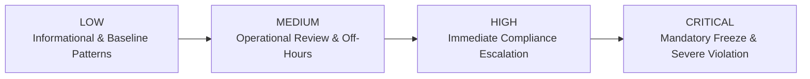
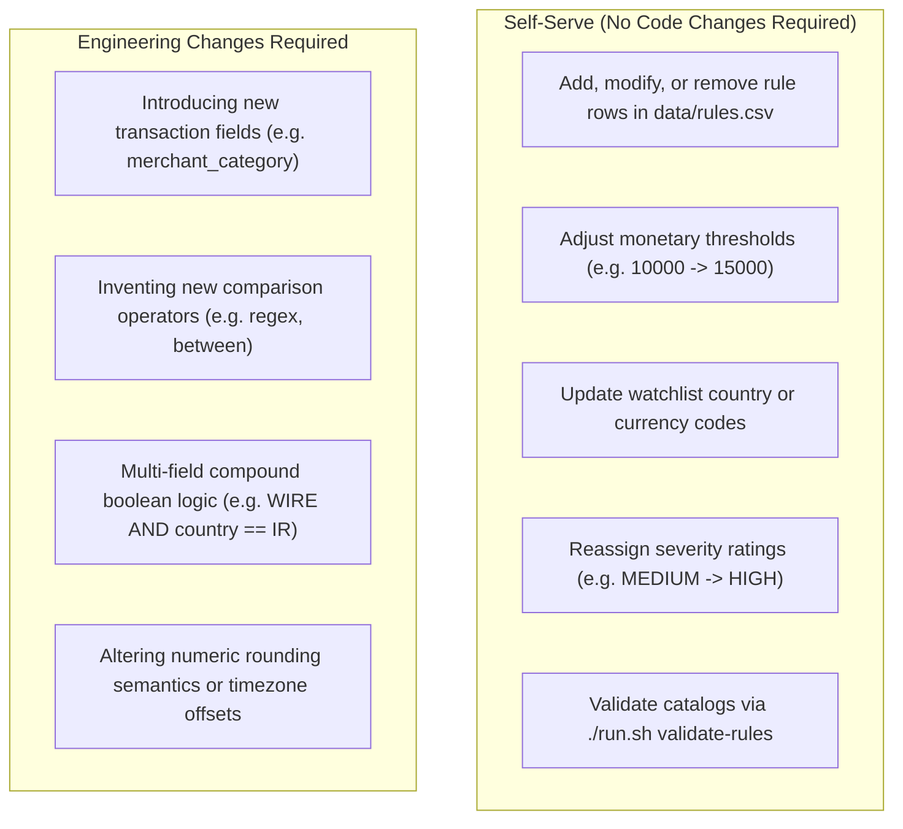

# Compliance Rules Specification & Authoring Guide

This specification defines the syntax, evaluation semantics, validation lifecycle, and governance boundaries for compliance rules in the Transaction Compliance Evaluator.

It is written for:
- **Compliance Officers, Risk Analysts, and Auditors**: To author, tune, audit, and verify regulatory rules without engineering intervention.
- **Engineers & Platform Maintainers**: To maintain, validate, and extend the core evaluation engine.

---

## 1. Canonical Paths & Storage Architecture

Compliance evaluation follows a decoupled, data-driven architecture:

| Resource | Canonical Path | Description |
|---|---|---|
| **Primary Rule Catalog** | [`data/rules.csv`](file:///home/battlestarcoder/Downloads/exam/data/rules.csv) | Single source of truth for business compliance rules. Editable without compiling code. |
| **Transaction Dataset** | [`data/transactions.json`](file:///home/battlestarcoder/Downloads/exam/data/transactions.json) | Financial transaction records evaluated against the rule catalog. |
| **Engine Vocabulary** | `RuleEngine.java` / `./run.sh schema` | Programmatic contract defining permissible fields, types, and operator bindings. |

---

## 2. Rule Catalog File Specification (`rules.csv`)

Rules are stored as standard RFC 4180 CSV files.

### Exact Header Row
The file must begin with this exact comma-separated header line:
```csv
rule_id,rule_name,field,operator,value,severity
```

### Column Definitions

| Column | Required | Type | Validation Pattern / Allowed Values | Purpose & Evaluation Notes |
|---|---|---|---|---|
| `rule_id` | **Yes** | String | `^R\d+$` (e.g. `R001`, `R010`, `R105`) | Unique rule identifier. Breaches in compliance reports are sorted in ascending `rule_id` order. |
| `rule_name` | No | String | Free text identifier (e.g. `large_transaction`) | Human-readable descriptor. Used in audit logs, diagnostics, and web dashboard labels. |
| `field` | **Yes** | String | Must match an entry in the [Field Vocabulary](#3-field-domain-vocabulary--types) | The transaction attribute or derived metric being evaluated. |
| `operator` | **Yes** | String | `gt`, `lt`, `eq`, `neq`, `in` | Comparison operation. Must be compatible with the target field type. |
| `value` | **Yes\*** | String | Context-dependent (scalar or quoted comma-separated list) | Threshold or target comparison value. (\*Required for evaluation; validator rejects empty values). |
| `severity` | **Yes** | Enum | `LOW`, `MEDIUM`, `HIGH`, `CRITICAL` | Breach classification level. Appears alongside `rule_id` in reports. |

### Formatting, Quoting, and Normalization Rules
1. **Whitespace Trimming**: Whitespace surrounding commas, field names, operators, and cell values is trimmed automatically.
2. **List Values (`in` operator)**: Multiple target values must be wrapped in standard CSV double quotes and comma-separated, e.g. `"IR,KP,SY"`. Whitespace around individual list items is trimmed. Empty list items (e.g. `"IR,,KP"`) are strictly invalid.
3. **Leading Zeroes on UTC Hours**: Hour values such as `"05"` or `"01,02"` are automatically canonicalized to integer representations (`"5"`, `"1,2"`).
4. **Case Sensitivity**: Field names and operators must be **lowercase** (`amount`, `gt`, `in`). Severities must be **uppercase** (`HIGH`, `CRITICAL`). String values match with exact case sensitivity.

---

## 3. Field Domain Vocabulary & Types

The engine supports eight canonical fields spanning monetary, temporal, categorical, and entity domains:

| Field Name | Logical Type | Format / Constraints | Rounding & Normalization Rules | Description |
|---|---|---|---|---|
| `amount` | `number` | Positive decimal number (e.g. `15000.00`, `250.50`) | **Ceiling Rounding**: If a transaction contains 3+ decimal places, it is rounded up to two decimal places (`RoundingMode.CEILING`). Standard amounts format to 2 decimal places (`15000` -> `15000.00`). Negative numbers are rejected. | Monetary value of the transaction. Evaluated numerically via `BigDecimal`. |
| `timestamp.hour` | `hour` | Integer in range `0`..`23` | Canonicalized to unpadded integer (e.g. `"03"` -> `3`). | Extracted UTC hour component of the ISO-8601 transaction timestamp (`ZoneOffset.UTC`). |
| `country` | `string` | 2-letter uppercase ISO 3166-1 alpha-2 code (e.g. `US`, `GB`, `IR`, `KP`) | Uppercase string match. | Country where transaction originated or settled. |
| `currency` | `string` | 3-letter uppercase ISO 4217 code (e.g. `USD`, `EUR`, `GBP`) | Uppercase string match. | Currency denomination of the transaction amount. |
| `transaction_type` | `string` | Uppercase identifier (e.g. `WIRE_TRANSFER`, `PAYMENT`, `WITHDRAWAL`) | Trimmed string match. | Classification method or payment rail used. |
| `account_type` | `string` | Uppercase identifier (e.g. `PERSONAL`, `BUSINESS`, `PRIVATE`) | Trimmed string match. | Classification of the initiating customer account. |
| `customer_id` | `string` | Alphanumeric identifier (e.g. `CUST001`) | Case-sensitive string match. | Unique entity identifier of the customer. |
| `transaction_id` | `string` | Alphanumeric identifier (e.g. `TXN001`) | Case-sensitive string match. | Unique transaction identifier. |

---

## 4. Operator Compatibility Matrix

Operators determine how the transaction attribute is compared against the rule `value`:

| Operator Symbol | Mathematical Meaning | Permissible Field Types | Evaluation Logic | Example Usage |
|---|---|---|---|---|
| `gt` | Strict Greater-Than (`>`) | `number`, `hour` | Compares numerically using `BigDecimal.compareTo`. Boundary values are not breached (`10000 gt 10000` is `false`). | `amount gt 10000`<br>`timestamp.hour gt 22` |
| `lt` | Strict Less-Than (`<`) | `number`, `hour` | Compares numerically using `BigDecimal.compareTo`. Boundary values are not breached (`1000 lt 1000` is `false`). | `amount lt 1000`<br>`timestamp.hour lt 6` |
| `eq` | Exact Equality (`=`) | `number`, `hour`, `string` | Numeric equality for `number` (scale-agnostic: `100` equals `100.00`). Exact case-sensitive string equality for all other fields. | `currency eq USD`<br>`account_type eq BUSINESS` |
| `neq` | Not Equal (`!=`) | `number`, `hour`, `string` | Logical negation of `eq`. | `currency neq USD`<br>`country neq US` |
| `in` | Set Inclusion (`∈`) | `hour`, `string` | Evaluates whether the transaction field matches any item in the comma-separated target list. | `country in "IR,KP,SY"`<br>`timestamp.hour in "1,2,3,4,5"` |

### Field-to-Operator Support Matrix

| Field | `gt` | `lt` | `eq` | `neq` | `in` |
|---|:---:|:---:|:---:|:---:|:---:|
| `amount` | ✅ | ✅ | ✅ | ✅ | ❌ |
| `timestamp.hour` | ✅ | ✅ | ✅ | ✅ | ✅ |
| `currency` | ❌ | ❌ | ✅ | ✅ | ✅ |
| `country` | ❌ | ❌ | ✅ | ✅ | ✅ |
| `transaction_type` | ❌ | ❌ | ✅ | ✅ | ✅ |
| `account_type` | ❌ | ❌ | ✅ | ✅ | ✅ |
| `customer_id` | ❌ | ❌ | ✅ | ✅ | ✅ |
| `transaction_id` | ❌ | ❌ | ✅ | ✅ | ✅ |

---

## 5. Severity Classifications & Operational Triage

Every rule must declare one of four standardized severity ratings:



1. **`LOW`**: Informational flags or baseline traits that warrant tracking when combined with other indicators (e.g. non-USD currency, business accounts, micro-transactions).
2. **`MEDIUM`**: Standard monitoring alerts requiring post-settlement analyst verification (e.g. wire transfers, off-hours nocturnal transactions).
3. **`HIGH`**: Substantial risk triggers requiring immediate investigation (e.g. high-value transactions exceeding standard AML thresholds, transactions originating from high-risk or OFAC-sanctioned jurisdictions).
4. **`CRITICAL`**: Extreme compliance violations triggering mandatory transaction blocking or priority SAR (Suspicious Activity Report) filing (e.g. ultra-high value transfers > \$40,000, combined high-risk exposures).

---

## 6. Engine Behavior, Policies & Edge Cases

### Dual Ingestion Policies: Fail-Closed vs. Resilient Runtime

The evaluation system implements two complementary execution profiles:

1. **Fail-Closed Pre-Flight CLI Validator (`./run.sh validate-rules` and `./run.sh validate`)**:
   - Acts as a strict gatekeeper.
   - Detects all syntax errors, bad column headers, invalid regex formats, incompatible operators, domain out-of-bounds, or vacuous logic errors across the file.
   - Halts execution and exits with a **non-zero exit code (`1`)** if any problem exists.
2. **Fault-Tolerant Production Batch Evaluation (`./run.sh`)**:
   - Maximizes availability during automated batch processing.
   - If an invalid rule row is detected during live evaluation, the engine skips only the offending row, emits a structured SLF4J log error (`log.error("Skipping invalid rule on line N: ...")`), and continues evaluating all remaining valid rules across the transaction stream.

### Null Safety & Missing Optional Fields
- Transactions may omit optional fields (e.g. a transaction payload lacking `country` or `currency`).
- **Policy**: If a rule targets an absent or `null` field on a transaction, the condition evaluates to **`false`** (no breach), and an informational diagnostic is recorded.
- **Outcome**: Evaluator never crashes with `NullPointerException`, and false-positive breaches are eliminated.

### Monetary Rounding Policy
- Evaluated monetary amounts adhere to strict 2-decimal precision:
  $$\text{scale} > 2 \implies \text{round up with RoundingMode.CEILING}$$
- Example: An amount of `10000.001` rounds to `10000.01` and triggers an `amount gt 10000` rule.

### Vacuous Logic Prevention
The validator protects analysts against logically impossible or dead rules:
- **`timestamp.hour gt 23`**: Impossible because `23` is the maximum UTC hour.
- **`timestamp.hour lt 0`**: Impossible because `0` is the minimum UTC hour.
- **`amount lt 0`**: Impossible because all transaction amounts are strictly positive numbers.
- **Negative amounts** (e.g. `amount gt -100`): Rejected during validation.

---

## 7. Verification & Tooling Commands

Before committing rule updates to version control or rolling them out to production, run the pre-flight verification commands:

### A. Dedicated Rule Syntax & Semantic Validator
Rapidly checks rules CSV syntax and domain constraints without loading transaction datasets:
```bash
./run.sh validate-rules
# Or test an arbitrary file:
./run.sh validate-rules path/to/rules.csv
```
*Sample Output on Clean Catalog:*
```
OK: rules are valid
```
*Sample Output on Error (exits non-zero):*
```
[ERROR] Validation failed with 2 error(s):
  - rules row 4: operator 'gt' is not valid for field 'country' (allowed: [eq, in, neq])
  - rules row 9: 'gt 23' on timestamp.hour can never match (23 is the max hour)
```

### B. Full Cross-Dataset Validator
Validates both transaction JSON structure and rule CSV integrity:
```bash
./run.sh validate
# Or with explicit file paths:
./run.sh validate data/transactions.json data/rules.csv
```

### C. Live Schema Vocabulary Introspection
Dumps the active schema rules, field types, and supported operators directly from the engine runtime in JSON format:
```bash
./run.sh schema
```
*Output:*
```json
{
  "fields": [
    {"name": "amount", "type": "number", "operators": ["gt", "lt", "eq", "neq"]},
    {"name": "currency", "type": "string", "operators": ["eq", "neq", "in"]},
    {"name": "country", "type": "string", "operators": ["eq", "neq", "in"]},
    {"name": "transaction_type", "type": "string", "operators": ["eq", "neq", "in"]},
    {"name": "account_type", "type": "string", "operators": ["eq", "neq", "in"]},
    {"name": "customer_id", "type": "string", "operators": ["eq", "neq", "in"]},
    {"name": "transaction_id", "type": "string", "operators": ["eq", "neq", "in"]},
    {"name": "timestamp.hour", "type": "hour", "operators": ["gt", "lt", "eq", "neq", "in"], "min": 0, "max": 23}
  ],
  "severities": ["LOW", "MEDIUM", "HIGH", "CRITICAL"]
}
```

### D. Rule Studio Interactive Web UI
For non-technical analysts, launch the visual Rule Studio to compose, validate, and preview rules interactively:
```bash
./start-web.sh
# Alternatively using Docker:
docker compose up web
```
Navigate to **`http://localhost:3000`** in any web browser.
- Interactive dropdowns enforce valid field and operator pairings.
- Live rule preview generates valid CSV syntax.
- Pre-flight validation prevents saving malformed rows to disk.

---

## 8. Practical Worked Examples

The following real-world scenarios illustrate how business requirements map to `rules.csv` records:

### Scenario 1: High-Value Transaction Threshold
*Business Requirement*: Flag any transaction exceeding \$10,000 for standard AML review.
```csv
R001,large_transaction,amount,gt,10000,HIGH
```

### Scenario 2: Ultra-High Value Escalation
*Business Requirement*: Immediately flag transfers exceeding \$40,000 as critical alerts.
```csv
R004,very_large_transaction,amount,gt,40000,CRITICAL
```

### Scenario 3: Micro-Payment Surveillance
*Business Requirement*: Flag transactions strictly under \$1,000 for structuring or smurfing checks.
```csv
R005,small_payment,amount,lt,1000,LOW
```

### Scenario 4: Sanctioned & High-Risk Jurisdictions
*Business Requirement*: Flag transactions originating from or terminating in FATF/OFAC high-risk jurisdictions.
```csv
R002,high_risk_country,country,in,"IR,KP,SY",HIGH
```

### Scenario 5: Nocturnal & Off-Hours Transfers
*Business Requirement*: Flag transactions occurring during high-risk off-hours (before 06:00 UTC or after 22:00 UTC).
```csv
R003,late_night_transaction,timestamp.hour,gt,22,MEDIUM
R009,early_morning_transaction,timestamp.hour,lt,6,MEDIUM
```
*(Note: Hours run `0` to `23`. `lt 6` matches hours 0, 1, 2, 3, 4, 5. `gt 22` matches hour 23).*

### Scenario 6: Restricted Payment Methods
*Business Requirement*: Flag all wire transfers for secondary settlement clearance.
```csv
R006,wire_transfer,transaction_type,eq,WIRE_TRANSFER,MEDIUM
```

### Scenario 7: Foreign Currency Activity
*Business Requirement*: Flag any transaction conducted in a non-USD currency.
```csv
R008,non_usd_transaction,currency,neq,USD,LOW
```

### Scenario 8: Corporate Account Triage
*Business Requirement*: Tag corporate entity movements for specialized compliance reporting.
```csv
R007,business_account,account_type,eq,BUSINESS,LOW
```

---

## 9. System Boundaries & Governance

To maintain platform stability, clear boundaries define what compliance teams can configure autonomously versus what requires software engineering:



### Summary Matrix

| Capability | Self-Service (Compliance / Non-Dev) | Requires Code Change (Dev Team) | Implementation Reference |
|---|:---:|:---:|---|
| **Add or remove compliance rules** | ✅ Yes | ❌ No | Update [`data/rules.csv`](file:///home/battlestarcoder/Downloads/exam/data/rules.csv) directly |
| **Adjust monetary thresholds** | ✅ Yes | ❌ No | Change `value` column for `amount` rules |
| **Expand jurisdiction watchlists** | ✅ Yes | ❌ No | Add ISO codes to `in` list (e.g. `"IR,KP,SY,RU"`) |
| **Change rule severities** | ✅ Yes | ❌ No | Update `severity` column to desired tier |
| **Introduce new transaction fields** | ❌ No | ✅ Yes | Update `Transaction.java`, `RuleEngine.FIELDS`, and `RuleEngine.fieldValue()` |
| **Add new comparison operators** | ❌ No | ✅ Yes | Extend `Operator.java` enum and `RuleEngine.allowedOperators()` |
| **Compound multi-condition rules** | ❌ No | ✅ Yes | Individual rules currently evaluate independently; compound logic requires composite engine expansion |
| **Custom rounding or timezones** | ❌ No | ✅ Yes | Modify `RuleEngine.roundAmount()` or `ZoneOffset.UTC` |

---

## 10. Rule Authoring Checklist

Before deploying changes to `data/rules.csv`, complete this five-point verification:

- [ ] **1. Canonical Header**: The first row contains exactly `rule_id,rule_name,field,operator,value,severity`.
- [ ] **2. Unique Rule ID**: Every rule has a unique ID conforming to `^R\d+$` (e.g. `R010`).
- [ ] **3. Valid Field & Operator**: Field is declared in the vocabulary and the operator is compatible (e.g. no `gt` on `country`).
- [ ] **4. Proper Quoting on Lists**: Comma-separated lists for `in` operators are enclosed in quotes (`"IR,KP,SY"`).
- [ ] **5. Clean CLI Validation**: `./run.sh validate-rules` executes cleanly with exit code `0`.
